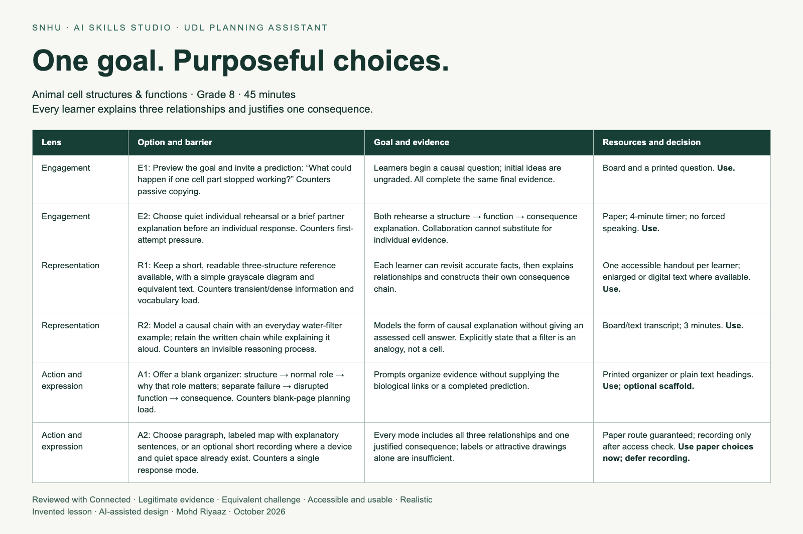

# UDL Planning Assistant

A reusable ChatGPT Project and a reviewed lesson-design portfolio for Southern New Hampshire University's **Create a Universal Design Lesson Planner** mission in Handshake AI Skills Studio.

Prepared for Mohd Riyaaz with AI assistance, 7 October 2026. Both lesson contexts are invented; no student profiles or classroom outcome claims are included.

## Deliverables

- [Final options menu and teaching materials](options-menu.md)
- [Reusable assistant instructions](assistant-instructions.txt), copied unchanged from the mission and saved in the ChatGPT Project
- [Biology planning and review transcript](transcripts/biology.txt)
- [Second-lesson transcript](transcripts/workplace.txt)
- [Stress-test transcript](transcripts/stress-test.txt)
- [Lesson input template with exact CLEAR questions](lesson-input-template.txt)
- [Saved-assistant reuse verification](transcripts/saved-assistant-reuse.txt)
- [Review and test findings](review.md)
- [Submission document](UDL-Planning-Portfolio.pdf)

## Reuse

Create a ChatGPT Project and paste `assistant-instructions.txt` into its project instructions. Start a new chat with the audience, observable goal, current lesson, possible barriers, fixed requirements, flexible methods, available time/tools, and accessibility constraints. Validate the assistant's barrier hypotheses before asking for options. Select a small set and inspect each against the unchanged goal and required evidence.

The saved owner project is [UDL Planning Assistant — SNHU](https://chatgpt.com/g/g-p-6ac58523a1e48191aae7a32d90d13a60/project). This private workspace link requires the owner's access; all submission evidence is also included in this repository.

## Framework attribution

The three UDL lenses are engagement, representation, and action and expression. **CLEAR is the mission's own alignment check**, not a CAST acronym: Connected, Legitimate evidence, Equivalent challenge, Accessible and usable, Realistic.

Source: [SNHU mission build brief](https://app.joinhandshake.com/learn/create-a-universal-design-lesson-planner-133192fd/mission_step_cmu4jtrug00hx28vdhtvtdkjb).

This is a planning demonstration, not evidence of classroom effectiveness or a claim of complete accessibility. A teacher should check the science, materials, timing and access needs in the actual setting before use.

## Rebuild the document

Use Python 3.9+ and Node.js with Google Chrome installed. Run `python -m pip install -r requirements.txt`, `npm ci`, `python build-documents.py`, then `npm run render`. The HTML is a local document source, not a hosted website.
